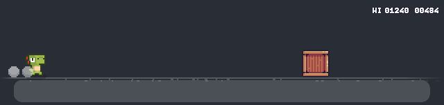

# Dockosaur

A tiny pixel dino that runs on top of your macOS Dock. Play it while you work: jump from any app without switching windows.



## Play

- **Jump:** tap **Right ⌥**, press **⌃⌥Space**, or click the strip. Hold to jump higher.
- **Jump** spikes, crates, saws and low-gliding hawks. **Stay down** under high-flying hawks.
- Grab fruit for +50. It speeds up as you go, and your best score is saved.

Clicks pass through to your windows unless the pointer is over the strip, and clicking it never takes focus from the app you're typing in. Right-click the strip for settings: dino colour, size, width, sound, autopilot, launch at login.

## Install with a prompt

Paste this into Claude Code:

```text
Install Dockosaur (https://github.com/pratikaman/dockosaur) on this Mac:

1. Clone it to ~/dockosaur. It needs the Xcode Command Line Tools; if swiftc is
   missing, tell me to run `xcode-select --install` and stop.
2. In ~/dockosaur run ./build.sh --install (builds, self-tests, copies to /Applications).
3. Run: open /Applications/Dockosaur.app
4. Tell me to allow Dockosaur in System Settings → Privacy & Security → Input Monitoring,
   so Right ⌥ can jump from any app. ⌃⌥Space and clicking work without it.
```

## Manual install

```sh
git clone https://github.com/pratikaman/dockosaur ~/dockosaur
cd ~/dockosaur && ./build.sh --install && open /Applications/Dockosaur.app
```

Needs macOS 14+.

## Credits

- Dinos: [Dino Characters](https://arks.itch.io/dino-characters) by Arks ([@ArksDigital](https://twitter.com/ArksDigital)),
  licensed [CC BY 4.0](https://creativecommons.org/licenses/by/4.0/). Used unmodified.
- Hawks: [Animated Birds](https://opengameart.org/content/animated-birds-32x32) by MoikMellah, CC0 (magenta background made transparent).
- Spikes, crates, saw, fruit and font: [Pixel Adventure](https://pixelfrog-assets.itch.io/pixel-adventure-1) by Pixel Frog, CC0
